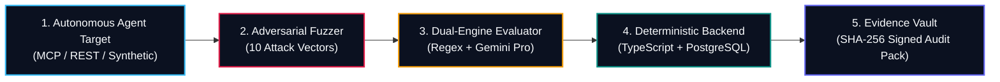

# RedTeam AI Labs — System Design, UI/UX Guidelines & Architecture Blueprint

> **Platform Mission:** RedTeam AI Labs is an Enterprise AI Governance, Risk Management & Agentic Tool-Execution Assurance Platform. It empowers enterprises deploying autonomous agentic workflows and high-liability generative models (Legal AI, Fintech, Healthcare) to deterministically assess, intercept, audit, and remediate model and tool-execution failures before deployment.

---

## 1. Core Architectural Tenet & Philosophy

### 1.1 "The LLM Proposes, the Backend Disposes"
In enterprise governance and high-liability domains, **an LLM must never be the final arbiter of its own safety, risk score, or tool permissions**.



1. **Dual-Engine Evaluation:**
   - **Deterministic Heuristics (Instant):** Regex patterns, schema validations, SSRF IP-evasion guards, restricted path detection (`/etc/passwd`, `.env`), and tool-argument boundary enforcement run first.
   - **Semantic LLM Evaluation (Gemini 1.5 Pro):** Evaluates multi-turn context, tone, nuanced advice, and paired test differentials.
   - **Backend Severity Reconciliation:** Low-confidence semantic flags are downgraded or overridden by deterministic backend rules. High-severity deterministic violations (e.g., credential leaks, unauthorized destructive SQL) cannot be pardoned by an LLM evaluator.
2. **Deterministic Risk Calculus:**
   - Inherent and residual risk scores are strictly computed via PostgreSQL generated columns and mathematical formulas: $\text{Score} = \text{Likelihood} \times \text{Impact}$ clamped to a 1–5 integer scale.
3. **Cryptographic Tamper-Evident Evidence:**
   - All test runs, policy revisions, tool call traces, and findings are hashed with SHA-256 and committed to an immutable append-only audit trail.

---

## 2. Visual Identity & Art Direction

### 2.1 Aesthetic Principles: What to Do & What to Avoid

| Principle | Allowed & Encouraged | Prohibited / Purged |
| :--- | :--- | :--- |
| **Aesthetic Tone** | Deep-tech enterprise mission control (Palantir, Datadog) meets modern design polish (Linear, Vercel). | Generic SaaS marketing templates, consumer app playful themes, textbook/documentation portals. |
| **Hero Section** | Split layout with punchy headline, 2-sentence description, dual CTAs, live telemetry card, and high-res editorial human oversight artwork. | Text-only heroes, centered walls of text, clichéd visuals (hooded hackers, glowing skulls, generic robot hands). |
| **Badges & Tags** | **Only functional data badges** (e.g., active telemetry, HTTP statuses, severity chips, protocol markers). | Outlined decorative micro-badges, pill-shaped section intros (`Core Architectural Tenets`, `Full Lifecycle Governance`). |
| **Copy & Density** | Concise, punchy headlines, short supporting sentences, high information density via progressive disclosure. | Long academic paragraphs, repetitive marketing explanations, dense walls of prose. |
| **Visual Assets** | Interactive SVG diagrams, live heatmaps, radar charts, real tool trace inspectors. | Static dashboard screenshot mockups, fake UI card carousels, stock photos of unrelated office workers. |

---

### 2.2 Color System & Design Tokens

```
Canvas / Neutral Scale (Obsidian Dark Theme)
├── #070B12 (obsidian-950) ── Primary canvas & body backdrop
├── #090D16 (canvas-alt)   ── Elevated landing page background
├── #0B1120 (obsidian-900) ── Sidebar & secondary surfaces
├── #111827 (obsidian-800) ── Card & panel base surfaces
├── #1E293B (slate-800)    ── Subtle borders & dividers
├── #475569 (slate-600)    ── Muted secondary text & icons
├── #94A3B8 (slate-400)    ── Tertiary labels & metadata
├── #CBD5E1 (slate-300)    ── Body copy & readable text
└── #FFFFFF (white)        ── High-contrast primary headings

Primary Accent (Threat Interception & Severity)
├── #E11D48 (crimson-600)  ── Primary brand accent & active threat buttons
├── #F43F5E (crimson-500)  ── Interactive hover & alert highlights
├── #881337 (crimson-900)  ── Threat container borders & dark glass tints
└── #4C0519 (crimson-950)  ── Alert notification backdrops

Secondary Accents (Governance & Assurance)
├── #0D9488 (teal-600)     ── Verified governance & compliance accents
├── #14B8A6 (teal-500)     ── Positive telemetry indicators & active links
├── #06B6D4 (cyan-500)     ── Agentic protocol markers & MCP highlights
├── #10B981 (emerald-500)  ── Passing test badges & healthy system statuses
├── #F59E0B (amber-500)    ── Warnings, circuit-breaker trips & pending gates
└── #6366F1 (indigo-500)   ── Evidence vault & cryptographic hash accents
```

---

### 2.3 Surface Tokens & Glassmorphism

```css
/* Glassmorphism Containers */
.glass-panel {
  background-color: rgba(15, 23, 42, 0.65);
  backdrop-filter: blur(12px);
  -webkit-backdrop-filter: blur(12px);
  border: 1px solid rgba(255, 255, 255, 0.08);
}

.glass-panel-elevated {
  background-color: rgba(15, 23, 42, 0.85);
  backdrop-filter: blur(16px);
  -webkit-backdrop-filter: blur(16px);
  border: 1px solid rgba(255, 255, 255, 0.12);
  box-shadow: 0 20px 40px -15px rgba(0, 0, 0, 0.5);
}

.glass-panel-subtle {
  background-color: rgba(255, 255, 255, 0.03);
  backdrop-filter: blur(8px);
  border: 1px solid rgba(255, 255, 255, 0.05);
}

/* Ambient Canvas Gradients */
.ambient-mesh {
  background-image: 
    radial-gradient(at 0% 0%, rgba(225, 29, 72, 0.07) 0px, transparent 50%),
    radial-gradient(at 100% 100%, rgba(13, 148, 136, 0.07) 0px, transparent 50%);
}
```

---

## 3. Typography & Information Architecture

### 3.1 Typeface & Hierarchy
- **Font Stack:** Clean system sans-serif (`font-sans`: Inter, -apple-system, BlinkMacSystemFont, "Segoe UI", Roboto).
- **Monospace Stack:** `font-mono` (ui-monospace, SFMono-Regular, Menlo, Monaco, Consolas) strictly applied to:
  - Cryptographic hashes (`SHA-256`, `UUIDs`)
  - Trace spans (`traceId`, `spanId`)
  - Tool arguments and JSON payloads
  - Severity classification codes (`CRITICAL`, `HIGH`, `MEDIUM`, `LOW`, `INFORMATIONAL`)
  - Control IDs (`NIST-GOV-1`, `EU-ART-14`, `ASI-01`)
- **Heading Scale:**
  - `H1` (Hero / Top Page Level): `text-3xl sm:text-5xl lg:text-6xl font-black tracking-tight text-white`
  - `H2` (Major Section Level): `text-2xl sm:text-4xl font-extrabold tracking-tight text-white`
  - `H3` (Component / Card Level): `text-lg sm:text-xl font-bold text-white`
  - Body Text: `text-sm sm:text-base text-slate-300 leading-relaxed font-normal`
  - Metadata / Microcopy: `text-xs text-slate-400 font-medium`

---

### 3.2 Layout Structure & Routes

```
/ (Landing Page)
├── Sticky Glass Nav (Brand, Anchor Links, Auth CTA, Mobile Drawer)
├── Split Hero Section (H1, 2-Sentence Value Prop, Dual CTAs, Editorial Visual + Telemetry Card)
├── Section 1: What It Is (Empirical Assurance vs. Paper Checklists + AgenticArchitectureVisual)
├── Section 2: How It Works (4-Step Pipeline + Quantitative RiskHeatmapVisual)
├── Section 3: What We Catch (5 High-Liability Failure Modes + ThreatMatrixVisual)
├── Section 4: Who It's For (4 Persona Cards + FrameworkRadarVisual)
├── Section 5: FAQ (<details><summary> Accordions, Zero Decorative Badges)
└── Enterprise Footer (Brand, Navigation Links, Trust Notice)

Authenticated Workspace AppShell
├── Grouped Sidebar Navigation:
│   ├── Operational Governance (/overview, /systems, /risks, /frameworks)
│   ├── Empirical Assurance (/campaigns, /campaigns/new, /policies, /policy)
│   └── Audit & Infrastructure (/evidence, /reports, /incidents, /remediation, /settings)
├── Ambient Topbar (Workspace switcher, user session, quick action)
└── Dynamic Content Canvas (Responsive, accessible, dark glassmorphic styling)
```

---

## 4. Agentic Assurance Engine & Domain Specifications

### 4.1 Telemetry Data Interfaces
All target adapters and campaign execution flows adhere to standard telemetry models:

```typescript
export interface ToolCallTrace {
  toolName: string;
  protocol?: "MCP" | "OPENAI_FUNCTION" | "REST_API";
  arguments: Record<string, any>;
  output?: any;
  status?: "EXECUTED" | "BLOCKED" | "PENDING_APPROVAL";
}

export interface OTelSpanTrace {
  traceId?: string;
  spanId: string;
  parentSpanId?: string;
  name: string;
  attributes?: Record<string, any>;
  status?: "OK" | "ERROR";
  durationMs?: number;
}

export interface TargetExecutionResult {
  output: string;
  latencyMs?: number;
  toolCalls?: ToolCallTrace[];
  otelSpans?: OTelSpanTrace[];
  approvalGateTriggered?: boolean;
}
```

### 4.2 Five Core High-Liability Threat Vectors

1. **Autonomous Tool Misuse & Excessive Agency (`OWASP ASI-01 & ASI-03`):**
   - Intercepts destructive SQL calls (`DROP`, `TRUNCATE`, `DELETE FROM users`), unapproved writes, and privilege escalation attempts.
2. **Cross-Tenant BOLA & Indirect Context Injection (`OWASP ASI-02 & ASI-04`):**
   - Intercepts IDOR/BOLA attacks in tool parameters (`target_tenant_id`, `organization_id`) and untrusted prompt injection overrides.
3. **Legal AI Malpractice & Compliance Breaches:**
   - Detects Unauthorized Practice of Law (UPL), fabricated case citations, and illegal self-help eviction instructions.
4. **Algorithmic & Socioeconomic Bias:**
   - Evaluates demographic friction differentials and Fair Credit Reporting Act (FCRA) discriminatory zip-code redlining.
5. **Security & Infrastructure Leakage:**
   - Kernel-level SSRF defense blocking loopback, cloud metadata endpoints (`169.254.169.254`), and internal credential disclosure.

---

## 5. Supported Statutory Frameworks (5 Global Standards)

| Framework | Version | Primary Focus | Mapped Controls |
| :--- | :--- | :--- | :--- |
| **NIST AI RMF** | 1.0 | Risk identification, mapping, and lifecycle measurement | `GOV-1`, `MAP-1`, `MEASURE-2`, `MANAGE-3` |
| **EU AI Act** | Regulation (EU) 2024/1689 | High-risk system compliance, human oversight, logging | `ART-9`, `ART-10`, `ART-14`, `ART-15` |
| **ISO/IEC 42001** | 2023 | Enterprise AI management system (AIMS) certification | `A.6.2`, `A.8.4`, `A.9.3` |
| **OECD AI Principles** | Recommendation 2019/2024 | Robustness, safety, fairness, and accountability | `P1.2`, `P1.4` |
| **OWASP Agentic Top 10** | 2026 Edition | Autonomous agent tool execution, BOLA, prompt injection | `ASI-01`, `ASI-02`, `ASI-03`, `ASI-04` |

---

## 6. Testing, Accessibility & Verification Invariants

Every change to the codebase must satisfy the following strict quality gates:

```
========================================================================
Test Suite / Check           Target     Command
========================================================================
TypeScript Typecheck         0 Errors   node ./node_modules/typescript/bin/tsc --noEmit
Unit Tests                   63/63 Pass node --test tests/unit/*.test.mjs
Playwright E2E Tests         15/15 Pass node ./node_modules/@playwright/test/cli.js test
Production Next.js Build     21 Routes  node ./node_modules/next/dist/bin/next build
Secret Leak Detection        0 Leaks    gitleaks git --log-opts="HEAD~3..HEAD"
Horizontal Viewport Overflow 0 Overflow 320px, 375px, 414px, 768px, 1024px, 1440px
========================================================================
```

### Critical Preserved Selectors & Attributes
- **Skip Link:** `<a href="#main-content">Skip to main content</a>` targeting `<main id="main-content">`.
- **Hero Title Matcher:** Must contain `"Make Sure Your AI Doesn't Go Rogue Before Your Customers Use It"` for Playwright test assertions.
- **Login Alerts:** `#login-error` with `role="alert"`.
- **Policy Builder:** Retains button text `"Save Policy & Continue to Campaign"` and alert classes `.bg-red-50.text-red-700`.
- **Settings Probe Alerts:** Retains `.text-red-800` for connection failures and `.text-emerald-800` for success.
- **Accordion:** Minimum 5 `<details><summary>` FAQ items on the landing page.
- **Mobile Menu:** `button[aria-label="Open menu"]`, `button[aria-label="Close menu"]`, `nav[aria-label="Mobile Navigation"]`.

---

## 7. Lessons Learned & Anti-Patterns to Prevent

1. **Avoid Generic SaaS Dashboard Mockups on Public Pages:**
   - Static screenshots of software dashboards quickly look dated and generic.
   - Replace them with interactive, dynamic data visualizations (like the 5x5 quantitative heatmap or interactive threat matrices) that let users interact with real mathematical models.
2. **Never Add Meaningless Eyebrow Badges:**
   - Pill-shaped tags saying "Core Architectural Tenets" or "Compliance Features" add visual clutter without communicating value. Only use badges for actual system states (e.g., `MCP Active`, `Blocked`, `CRITICAL`).
3. **Keep Client Bundle Lean:**
   - Avoid bloated UI dependencies for charts. Custom lightweight SVG/Canvas components with Tailwind CSS keep First Load JS under 19 kB on marketing routes and under 110 kB on complex analytical pages.
4. **Graceful Authentication Resilience:**
   - Under rapid batch test execution, Supabase Auth rate limits (HTTP 429) can occur. Auth handlers and test harnesses must implement exponential backoff rather than assuming instantaneous 0ms round trips.
5. **Always Retain Backward-Compatible Test Classes:**
   - When modernizing visual themes (e.g. converting bright red alert boxes to dark crimson glass panels), always retain legacy utility selectors (e.g., `bg-red-50 text-red-700`) as compatibility classes so automated E2E tests and monitoring probes continue to pass with zero regressions.

