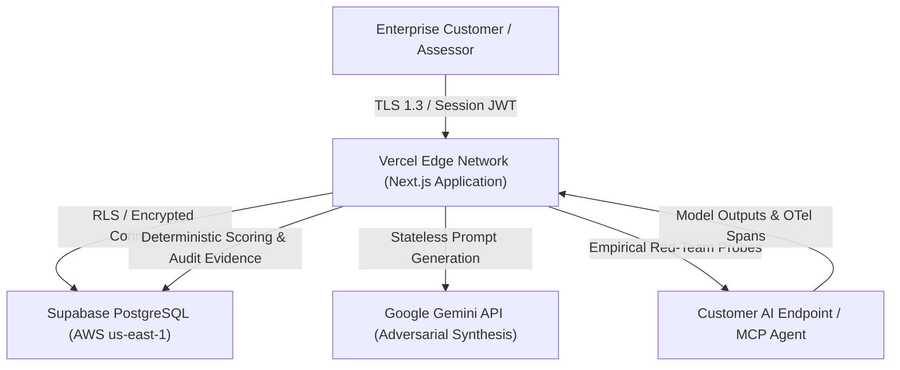

# RedTeam AI Labs — Data Protection Impact Assessment (DPIA)
**Operating Entity:** Lisumen Innovative Hub  
**Product:** RedTeam AI Labs (Enterprise AI Governance & Assurance Platform)  
**Primary Statutory Basis:** Nigeria Data Protection Act 2023 (NDPA Section 28 & 39), NDPC Guidelines, and GDPR Article 35  
**Version:** 1.0.0  
**Effective Date:** November 9, 2026  
**Status:** Operational Compliance Template  

---

## 1. Executive Summary & Assessment Scope
This Data Protection Impact Assessment (DPIA) evaluates the data protection risks, statutory impact, and technical risk mitigations associated with the deployment and operation of **RedTeam AI Labs**.

RedTeam AI Labs is an enterprise software platform designed to register AI systems, evaluate generative AI models and autonomous Model Context Protocol (MCP) agents, score inherent and residual risks on a 5x5 quantitative matrix, and generate cryptographically signed audit evidence.

---

## 2. Systematic Description of Processing Activities
### 2.1 Nature, Scope, Context, and Purpose
- **Nature of Processing:** Ingestion, storage, analysis, synthetic adversarial probing, and automated scoring of AI systems, user-provided prompt datasets, and model execution traces.
- **Scope:** Enterprise customers, system administrators, governance leads, and AI safety assessors.
- **Context:** Automated red-teaming of high-liability generative systems across legal technology, financial services, healthcare triage, and autonomous multi-agent environments.
- **Purpose:** Enabling enterprise compliance with the Nigeria Data Protection Act 2023, EU AI Act (Regulation (EU) 2024/1689), NIST AI RMF 1.0, ISO/IEC 42001, and OWASP Top 10 for Agentic AI.

### 2.2 Data Flows and Architecture

### 2.3 Subprocessors & Technical Infrastructure
| Subprocessor | Processing Activity | Location | Transfer Mechanism |
| :--- | :--- | :--- | :--- |
| **Supabase Inc.** | PostgreSQL database, Supabase Auth, Row-Level Security, Encrypted session store | AWS us-east-1 (USA) | Standard Contractual Clauses (SCCs), NDPA Section 41 |
| **Vercel Inc.** | Application hosting, Edge CDN, Serverless compute | USA & Global Edge | SCCs, NDPA Section 41 |
| **Google LLC (Gemini API)** | Stateless generative prompt synthesis & semantic evaluation | USA | Enterprise API Terms (Zero Model Training) |

---

## 3. Assessment of Necessity and Proportionality
| Principle (NDPA Section 24) | Implementation in RedTeam AI Labs | Compliance Determination |
| :--- | :--- | :--- |
| **Lawfulness, Fairness & Transparency** | Processed under Contractual Necessity (NDPA s. 25(1)(b)) and Legitimate Interests (s. 25(1)(e)). Clear public Privacy Policy and DPA provided. | **COMPLIANT** |
| **Purpose Limitation** | Customer data is processed strictly to execute requested red-teaming campaigns and governance scoring. Never used for marketing or ad profiling. | **COMPLIANT** |
| **Data Minimization** | Only necessary account data (name, email, role) and technical session cookies (`sb-*-auth-token`) are collected. | **COMPLIANT** |
| **Storage Limitation** | Empirical retention horizons (12 months standard evidence; 30-day cascade purge upon customer deletion). | **COMPLIANT** |
| **Integrity & Confidentiality** | AES-256 encryption at rest, TLS 1.3 in transit, PostgreSQL Row-Level Security, SHA-256 evidence hashing. | **COMPLIANT** |

---

## 4. Assessment of Risks to the Rights and Freedoms of Data Subjects
| Risk ID | Identified Threat Event | Inherent Likelihood (1-5) | Inherent Impact (1-5) | Inherent Score | Mitigating Technical & Organizational Measure | Residual Likelihood | Residual Impact | Residual Score |
| :--- | :--- | :---: | :---: | :---: | :--- | :---: | :---: | :---: |
| **R-01** | Cross-tenant data leakage (IDOR/BOLA) in multi-tenant environment | 3 | 5 | **15 (High)** | Mandatory PostgreSQL Row-Level Security (RLS) on all 22 tables; helper security functions (`is_workspace_member`); unit-tested workspace boundary enforcement. | 1 | 4 | **4 (Low)** |
| **R-02** | Credential stuffing or unauthorized access to customer audit evidence | 3 | 4 | **12 (Medium)** | Supabase Auth with bcrypt password hashing; IP sliding-window rate limiting on `/api/auth/login` (15 req/min); no client-side secret exposure. | 1 | 3 | **3 (Low)** |
| **R-03** | Server-Side Request Forgery (SSRF) when probing customer AI endpoints | 4 | 4 | **16 (High)** | Kernel-level SSRF guard blocking loopback (`127.0.0.1`), decimal IP encoding, IPv6 mapped addresses, and cloud metadata services (`169.254.169.254`). | 1 | 3 | **3 (Low)** |
| **R-04** | AI model hallucination or false confidence in flawed AI models | 4 | 4 | **16 (High)** | Architectural tenet: "The LLM Proposes, the Backend Disposes." Deterministic backend rules in PostgreSQL compute all final scores. Clear AI Accuracy Disclaimer. | 2 | 3 | **6 (Medium)** |
| **R-05** | Unauthorized third-party model training on customer prompts | 3 | 5 | **15 (High)** | Integration with Google Gemini via paid Enterprise API tier. Contractual commitment that API inputs/outputs are never used to train base foundation models. | 1 | 4 | **4 (Low)** |

---

## 5. Stakeholder Consultation & Sign-Off
- **Data Protection Officer (DPO) Consultation:** Conducted review against NDPA 2023 requirements and NDPC Guidance Notice on Data Protection Compliance.
- **Security Engineering Review:** Verified database RLS policies, automated Playwright E2E suites, and static analysis (Gitleaks, Trivy misconfig).
- **Approved by:**  
  *Lisumen Innovative Hub Executive Management*  
  *Date:* November 9, 2026  
  *Review Horizon:* Annual or upon material architectural changes.

