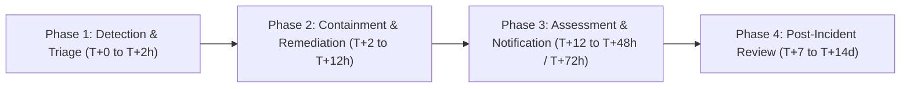

# RedTeam AI Labs — Data Breach Response Plan
**Operating Entity:** Lisumen Innovative Hub  
**Product:** RedTeam AI Labs  
**Statutory Authority:** Nigeria Data Protection Act 2023 (NDPA Section 40), NDPC Guidance, and GDPR Articles 33 & 34  
**Version:** 1.0.0  
**Effective Date:** November 9, 2026  

---

## 1. Objectives and Scope
This Data Breach Response Plan outlines the operational protocols, containment workflows, forensic procedures, and mandatory statutory notification timelines executed by **Lisumen Innovative Hub** upon discovering a suspected or confirmed security breach affecting personal or customer data within **RedTeam AI Labs**.

---

## 2. Breach Response Team (BRT)
| Role | Title / Designated Individual | Primary Responsibilities |
| :--- | :--- | :--- |
| **Breach Incident Commander** | Lead Systems Architect / Developer | Coordinates operational containment, forensic triage, and engineering remediation. |
| **Data Protection Officer (DPO)** | Compliance & Legal Lead | Assesses statutory threshold under NDPA s. 40, oversees regulatory filings to NDPC, and guides customer notifications. |
| **Technical Forensics Lead** | Platform Security Engineer | Inspects audit event logs, database query traces, Vercel edge telemetry, and identifies compromise vectors. |
| **Communications Lead** | Operations Lead | Manages customer notifications, public disclosures, and executive stakeholder updates. |

---

## 3. Four-Phase Breach Response Workflow

### Phase 1: Incident Detection, Recording, and Immediate Triage (0 - 2 Hours)
1. **Trigger Channels:** Automated intrusion alert, anomaly alert, subprocessor notification (Vercel, Supabase), or vulnerability disclosure via `security@redteamailabs.com`.
2. **Initial Severity Classification:**
   - **SEV-1 (Critical):** Confirmed exfiltration or unauthorized modification of customer database records, cross-tenant isolation failure, or compromised admin credentials.
   - **SEV-2 (High):** Unauthorized access to localized user account or transient credential exposure without verified database exfiltration.
   - **SEV-3 (Medium/Low):** Blocked penetration attempt, non-critical DoS anomaly, or isolated user credential leak.
3. **Log Freezing:** Snapshot `audit_events`, Supabase database WAL logs, and Vercel edge deployment telemetry for forensic analysis.

### Phase 2: Containment, Isolation, and Eradication (2 - 12 Hours)
1. **Credential Rotation:** Immediate revocation and rotation of compromised Supabase service role keys, Google Gemini API keys, and affected user sessions.
2. **Session Termination:** Invalidate active JWT tokens and flush session cookies for affected workspaces.
3. **Network Isolation:** Apply IP firewall blocks and update edge security headers if exploitation involves malicious origins.
4. **Patch Deployment:** Develop, test, and push code remediation with automated Playwright and unit test verification.

### Phase 3: Statutory Assessment and Mandatory Notifications (12 - 48/72 Hours)
1. **Notification to Affected Enterprise Customers (as Data Processor):**
   - **Timeline:** Notification within **forty-eight (48) hours** of confirmed breach, as committed in Section 6 of our Data Processing Agreement (DPA).
   - **Contents:** Incident description, affected workspaces, categories of records, remedial measures taken, and guidance for customer mitigation.
2. **Notification to the Nigeria Data Protection Commission (NDPC):**
   - **Statutory Mandate (NDPA Section 40(1)):** Where a personal data breach is likely to result in a risk to the rights and freedoms of data subjects, the Data Controller shall notify the NDPC within **72 hours** of becoming aware.
   - **Regulatory Filing Email:** `info@ndpc.gov.ng` / official NDPC incident portal.
3. **Notification to Data Subjects (NDPA Section 40(3)):**
   - Where the breach presents a **high risk** to the rights and freedoms of individuals, direct plain-language notifications will be issued to affected users via registered email without undue delay.

### Phase 4: Post-Incident Forensics and Corrective Action (7 - 14 Days)
1. Comprehensive Root Cause Analysis (RCA) authored by the Breach Response Team.
2. Updating security controls, regression tests, and RLS policies.
3. Submitting the Final Incident Report to the NDPC and executive management.

---

## 4. Emergency Contacts & Statutory Authorities
- **Internal Security Desk:** `security@redteamailabs.com` / [CONFIRMATION REQUIRED: Emergency Phone]
- **Nigeria Data Protection Commission (NDPC):** Plot 1238, Cadastral Zone B03, Garki II, Abuja (`info@ndpc.gov.ng`)
- **Nigeria Police Force National Cybercrime Centre (NPF-NCCC):** Abuja, Nigeria

