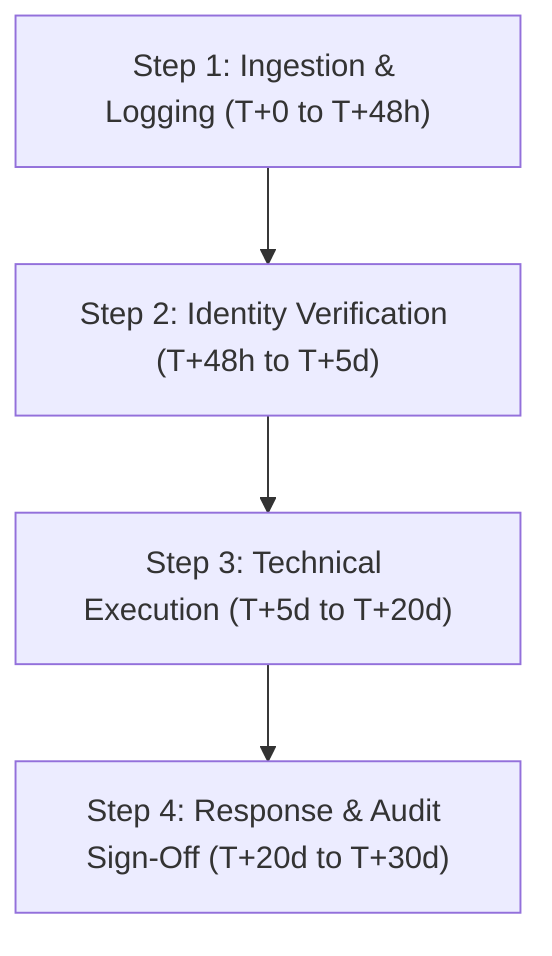

# RedTeam AI Labs — Data Subject Request (DSR) Handling Procedure
**Operating Entity:** Lisumen Innovative Hub  
**Product:** RedTeam AI Labs  
**Statutory Basis:** Nigeria Data Protection Act 2023 (NDPA Section 29, 34 & 35), NDPC Guidelines, and GDPR Articles 12-23  
**Version:** 1.0.0  
**Effective Date:** November 9, 2026  

---

## 1. Purpose and Scope
This Standard Operating Procedure (SOP) defines the operational workflow, verification standards, and strict statutory timelines executed by **Lisumen Innovative Hub** to fulfill Data Subject Requests (DSR) under the Nigeria Data Protection Act 2023 and global privacy frameworks.

---

## 2. Statutory Rights Recognized
1. **Right of Access (NDPA s. 29(1)(a)):** Confirmation of processing and copy of personal data.
2. **Right to Rectification (NDPA s. 29(1)(b)):** Correction of inaccurate or incomplete records.
3. **Right to Erasure (NDPA s. 29(1)(c)):** Deletion of personal data where retention lacks lawful grounds.
4. **Right to Restriction of Processing (NDPA s. 29(1)(d)):** Temporary suspension of processing.
5. **Right to Data Portability (NDPA s. 29(1)(e)):** Receipt of personal data in structured, machine-readable format (JSON/CSV).
6. **Right to Object (NDPA s. 29(1)(f)):** Objecting to processing based on legitimate interests.
7. **Right to Withdraw Consent (NDPA s. 29(1)(g)):** Withdrawing consent previously provided.

---

## 3. Four-Step Operational Handling Workflow

### Step 1: Intake and Central Logging (Within 48 Hours)
- **Intake Channels:**
  1. Interactive DSR Portal: `/legal/privacy-requests`
  2. Dedicated Email: `dpo@redteamailabs.com` / `privacy@redteamailabs.com`
- **Initial Action:** The DPO logs the request in the internal DSR Register, noting: Request ID, Date Received, Data Subject Name, Email, Right Invoked, and Statutory Deadline (T+30 Calendar Days).
- **Formal Acknowledgment:** An automated or written acknowledgment is dispatched within **forty-eight (48) hours**.

### Step 2: Identity Verification and Scope Assessment (Within 5 Business Days)
- **Authentication Check:** The DPO verifies that the requester is the authentic owner of the registered account email.
- **Role Determination:**
  - If the data subject is an **Account Holder**, Lisumen Innovative Hub acts as Data Controller and executes the request directly.
  - If the request targets **Customer AI Model Prompts or Evaluation Findings**, Lisumen Innovative Hub acts as Data Processor. The DPO immediately forwards the request to the relevant Customer Data Controller within **three (3) business days**.

### Step 3: Technical Execution in Database and Systems (Within 20 Days)
- **Access / Portability:** Query `workspace_members`, `audit_events`, and user profile data; export as structured JSON or CSV.
- **Rectification:** Update user record in Supabase Auth and `workspace_members`.
- **Erasure:** Execute cascade deletion of the user ID across `workspace_members`, notify relevant Workspace Admins, and delete the Supabase Auth profile. Immutable security audit logs (`audit_events`) are sanitized of personal identifiers while preserving required forensic non-repudiation records under the Cybercrimes Act 2015.

### Step 4: Final Response and Audit Sign-Off (Strictly Within 30 Calendar Days)
- The DPO dispatches a formal completion letter to the data subject via encrypted email.
- The request is closed in the DSR Register with timestamped forensic evidence of fulfillment.
- If an extension of up to thirty (30) additional days is required due to extraordinary complexity (permitted under NDPA s. 29), a formal written explanation must be served on the data subject prior to the initial 30-day expiry.

